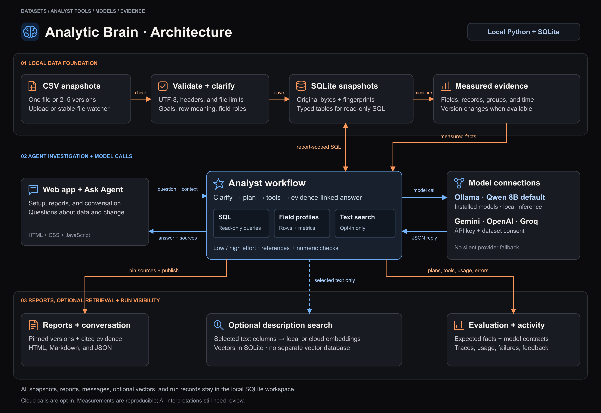
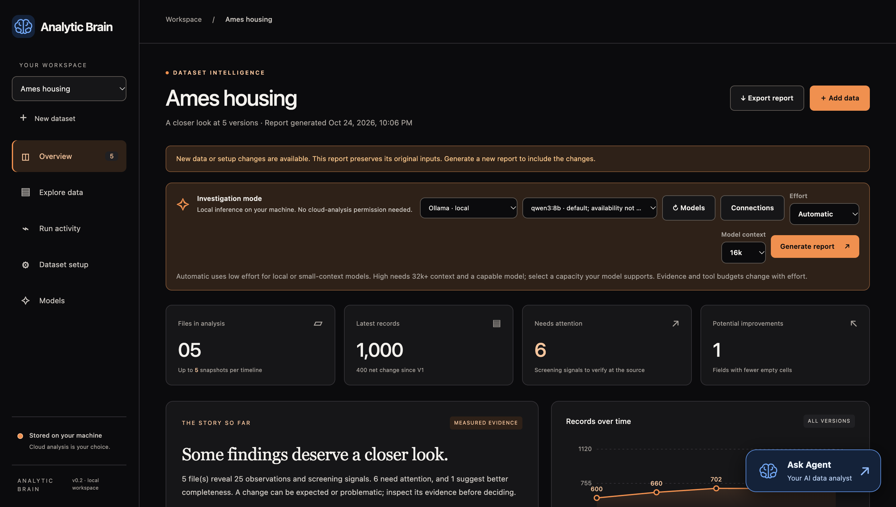
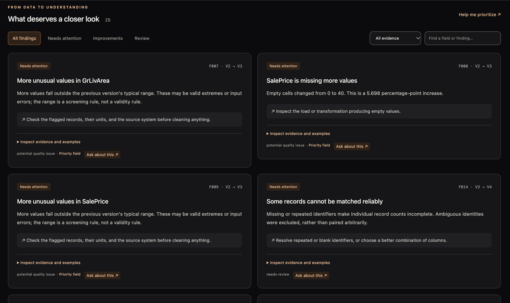
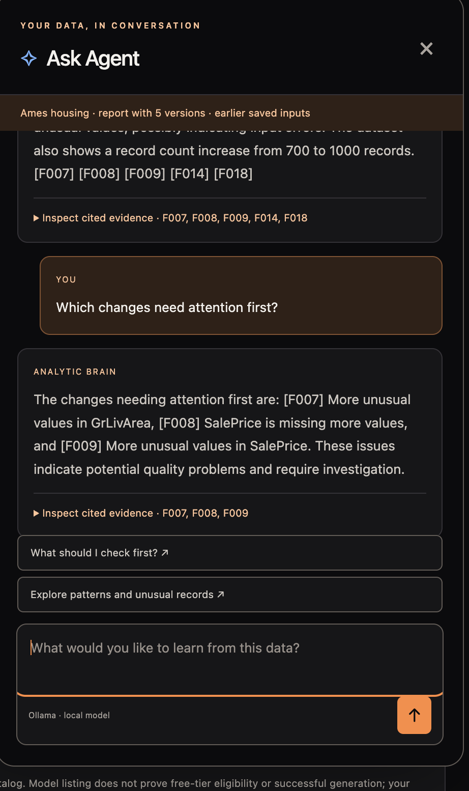

# Analytic Brain

Explore one dataset or compare up to five versions with an AI data analyst. Find missing values, unusual records, group differences, and changes over time, then ask questions with source evidence.

The app runs locally with SQLite storage and a black-and-orange interface. Use local Ollama models (Qwen 8B by default), or connect Gemini, OpenAI, or Groq. Cloud analysis is optional.

## Architecture



[Explore the architecture](docs/architecture.md) · [Editable diagram](docs/diagrams/architecture.svg)

## App preview

The housing demo shows version comparisons, investigation controls, and the **Ask Agent** launcher.

### Overview



### Findings and follow-up checks



### Ask Agent with cited evidence



## Run locally

Python 3.9 or newer. The application has no third-party runtime dependencies.

```sh
python3 -m venv .venv
source .venv/bin/activate
python -m pip install --upgrade pip
python -m pip install -e .
analytic-brain --demo
```

Open [localhost:8765](http://127.0.0.1:8765). Omit `--demo` for an empty workspace. The existing `python -m reviso` and `reviso` commands remain available after installation.

Snapshots, reports, conversations, and saved connections stay in `.reviso/`, which is excluded from Git. Existing workspaces continue to work.

## What you can do

- Profile a single CSV or compare two to five complete snapshots.
- Clarify row meaning, important fields, category orders, and analysis goals.
- Investigate records through read-only SQL and evidence-linked chat.
- Choose low or high investigation effort and a supported model context.
- Optionally search description fields by meaning after selecting columns and a connection.
- Inspect model usage and export HTML, Markdown, or complete JSON evidence.

## Project layout

| Folder | Purpose |
| --- | --- |
| `src/reviso/` | Application, analysis, model connections, and browser assets |
| `tests/` | Unit and HTTP tests, shared test doubles, and reference fixtures |
| `scripts/` | Sample generation, evaluation, and static interface checks |
| `docs/` | Setup, methods, architecture, and development guidance |

## Development

```sh
python -m pip install -e '.[dev]'
ruff check src scripts tests
python -m unittest discover -s tests -v
python scripts/evaluate.py
python scripts/evaluate_single.py
node scripts/check_ui.mjs
```

Node 22 is needed only for the static interface checks. GitHub Actions runs the checks on Python 3.9 and 3.12 using Ubuntu 24.04.

Read the [usage guide](docs/usage.md), [architecture](docs/architecture.md), [methods and limits](docs/methods.md), [evaluation guide](docs/evaluation.md), or [development notes](docs/development.md).
