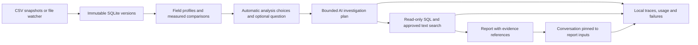

# Analytic Brain

**Your data, understood.**

Analytic Brain explores a single dataset or compares two to five versions, with an AI data analyst that can query the underlying records and cite its evidence. The local black-and-orange workspace combines reproducible measurements with guided analysis, a blue brain identity, and an analyst launcher at the bottom right.

Upload one CSV to begin. Use the optional question above **Generate report**, or leave it blank and start the analysis. The agent infers useful starting points from the fields and records; you can refine its interpretation in chat. Explore field meanings, missing values, ranges, unusual records, groups, relationships, and time coverage. Adding more versions enables record changes and possible field renames. Conversations remain linked to saved inputs.

## Run locally

Python 3.9 or newer. Install the project once with `python -m pip install -e .`. The app has no third-party runtime dependencies and does not need Node or an external database.

```sh
python3 -m reviso --demo
```

Open [Analytic Brain on localhost](http://127.0.0.1:8765). The demo uses the supplied housing CSV when available and falls back to generated housing data in a clean checkout. It creates five snapshots, a deliberately problematic import, repairs, a field rename, and a larger partner import. All listing descriptions in the demo are synthetic.

For an empty workspace:

```sh
python3 -m reviso
```

The visible product and installed command are **Analytic Brain** (`analytic-brain` after installation). The existing Python module `reviso`, request token header, browser preferences, and `.reviso/` storage remain compatible with prior workspaces.

The app stores snapshots, reports, conversations, and operational traces in `.reviso/reviso.sqlite`. The server binds to loopback. This first version is a personal local application; it has no hosted deployment or multi-user authentication.

## What you can do

- **Explore one file.** See suggested identifiers, nominal categories, ordinal ratings, numeric measures, dates, booleans, and text. Field meanings are inferred automatically, with uncertain interpretations labeled as assumptions. Profiles cover the full file; model context and displayed examples are bounded.
- **Guide the analysis.** The analyst can explore orders, doctors, claims, prices, supply chain, time series, and other data. Describe a goal in ordinary language if you have one. The analyst chooses initial measures, dates, and useful checks, and may ask a short follow-up after presenting findings.
- **Compare a timeline.** Inspect each neighboring pair and a separate first-to-latest comparison. Original source bytes and SHA-256 fingerprints are preserved.
- **Follow individual records.** Identifier-like columns are considered automatically using their names and first-snapshot completeness and uniqueness; the report records any provisional choice. Repeated or missing identifiers remain visible, with incomplete matching labeled explicitly. Without a usable identity, Analytic Brain compares row content without inventing edit counts.
- **Find changes worth investigating.** See record growth, removals, edits, completeness changes, new labels, type changes, numeric formatting, and unusual values. Flags suggest follow-up checks; they do not certify that records are wrong.
- **Resolve ambiguous field names.** Similar values can suggest a rename. Strong, unambiguous value matches are linked provisionally and uncertainty stays visible in the report. Discuss unclear meaning with the agent.
- **Chat with evidence.** Chat is available as soon as one file is uploaded, including before setup or a final report. A connected model can clarify your goals, inspect field profiles, investigate with bounded read-only SQL, and explain results with citations. Conversations remain scoped to the saved report. Chat immediately shows sending confirmation and an animated response indicator, updates during queries and provider waits, and keeps failed questions ready to retry. Evidence-only mode offers a clearly labeled evidence lookup and direct SQL.
- **Search descriptions by meaning.** Analytic Brain suggests prose-like columns and asks before embedding them. Optional vectors live in SQLite. Numeric and category-only workflows do not need an embedding service.
- **Inspect and export.** Read field profiles, query original version tables, inspect model/tool traces, leave run feedback, and export HTML, Markdown, or complete JSON evidence.

## Connect models

Open **Models** in the sidebar to configure four connections. Save an API key for a cloud provider or use its server environment variable. Choose **Refresh models** to load the provider's current text-model catalog, then select a model in the vertically arranged investigation controls. A custom model ID remains available for models the catalog does not classify. Connections can be configured before importing a dataset.

**Ask Agent** has its own **Connection** and **Model** selectors. Connections saved in **Models** become available in the chat selector immediately. Choose a listed model or **Custom model ID**, use **Models** in the chat panel to refresh its catalog, or open **Manage connections** to add or update provider settings. Chat and the investigation bar share the selection; changes apply to the next request. Selection is locked while an investigation runs. Cloud analysis still requires dataset permission.

Ollama is the initial selected provider and defaults to **`qwen3:8b`**. Start Ollama and refresh to choose among installed text models. If the default is absent, install it with `ollama pull qwen3:8b`. Analytic Brain never downloads models automatically. Local Ollama analysis works without cloud permission and has no cloud fallback.

| Connection | Environment key | Optional default model | API |
| --- | --- | --- | --- |
| Ollama | No key; `OLLAMA_BASE_URL` optionally changes the loopback address | `OLLAMA_MODEL`, initially `qwen3:8b` | Native local chat |
| OpenAI | `OPENAI_API_KEY` | `OPENAI_MODEL` | Responses |
| Gemini | `GEMINI_API_KEY` | `GEMINI_MODEL` | OpenAI-compatible chat |
| Groq | `GROQ_API_KEY` | `GROQ_MODEL` | OpenAI-compatible chat |

Saved defaults and keys apply to new runs; each run pins the connection settings it starts with. Secrets are written atomically to `.reviso/connections.json` with mode `0600`. This file is local and excluded from Git, but is **not encrypted** by Analytic Brain. Saved keys never appear in API responses, reports, or browser storage. A blank key keeps the configured key; **Remove saved key** removes the saved copy while preserving any environment configuration. [`configuration/env.example`](configuration/env.example) lists optional environment variables; `.env` is not loaded automatically.

Enable the dataset permission above **Generate report** or in **Ask Agent** before using OpenAI, Gemini, or Groq with dataset evidence. Local Ollama needs no cloud permission. **Evidence only** remains available as a separate mode with no model calls.

The Gemini and Groq connection cards let you record a free or paid API-account tier. The same adapter handles either tier. This label does not enforce a free budget, change your provider's billing, or establish that every listed model is available for free. The provider controls model access and quota. Quota failures appear in model usage without switching providers. Cloud costs remain **not priced**; local Ollama calls record no API token fee, excluding your hardware costs. Token counts come from provider responses.

For optional description search, select text fields, an Ollama, OpenAI, or Gemini embedding connection, and its embedding model ID in setup. Local Ollama embeddings do not require cloud consent; cloud embeddings do. Open the optional description-search section, select **Generate report**, then choose **Build text index**. Groq chat can use a separate embedding connection. An embedding build is resumable and does not rebuild completed cells. The chat-model picker excludes known embedding-only models; enter the embedding model ID in the separate text-search setup.

Official integration references: [OpenAI text generation](https://developers.openai.com/api/docs/guides/text), [Gemini compatibility](https://ai.google.dev/gemini-api/docs/openai), [Groq compatibility](https://console.groq.com/docs/openai), [OpenAI embeddings](https://developers.openai.com/api/reference/resources/embeddings/methods/create). Account terms, model access, and usage limits remain provider-controlled.

Live model catalogs use [OpenAI models](https://developers.openai.com/api/reference/resources/models/methods/list), [Gemini models](https://ai.google.dev/api/models), [Groq models](https://console.groq.com/docs/models), and [Ollama installed models](https://docs.ollama.com/api/tags). The local default is [Qwen3 8B](https://ollama.com/library/qwen3:8b).

## Rate limits and retries

Cloud calls using the same saved credential share a queue, including calls from different datasets or selected models. Free or automatic account settings use a short pacing interval. The client reads provider request/token allowance headers when available and waits for their reported reset before another call would exceed the remaining allowance. Input-token checks use conservative estimates; providers remain authoritative and other apps using the same account can consume capacity too.

A rate-limited request is attempted at most four times in total. The client respects `Retry-After` (including HTTP dates), or uses increasing waits of 15, 30, and 60 seconds when it is absent. The queue and cooldown have a three-minute waiting budget per model request. A longer daily/quota reset ends visibly instead of retrying early. Waiting and failed attempts appear in the progress panel and **Model usage**. There is no automatic switch to another model, provider, or paid tier. These controls apply to cloud connections; local Ollama has no cloud quota queue.

Groq chat uses registered function calls for application-validated SQL, profiles, optional semantic search, and final cited answers. Report planning and interpretation use JSON mode. Provider behavior is documented in [Groq tool calling](https://console.groq.com/docs/tool-use/local-tool-calling), [structured output](https://console.groq.com/docs/structured-outputs), and [rate limits](https://console.groq.com/docs/rate-limits).

## Choose investigation effort

The investigation bar offers **Automatic**, **Low**, and **High**, plus a model-context selector. Automatic chooses low for local models, smaller model names, or contexts under 32k; capable cloud models with at least 32k use high. The context selector declares capacity; it does not prove the model supports that capacity.

| Mode | Report queries | Chat tools | Output allowance |
| --- | --- | --- | --- |
| Low | Up to 2 | Up to 2, then a final answer | Up to 2,000 tokens, reduced for very small contexts |
| High | Up to 6 | Up to 6, then a final answer | Up to 8,000 tokens |

A report interpretation or final chat answer rejected by the evidence checks gets one additional correction call. The rejection remains visible in model usage; a second failure publishes no answer.

High requires a selected context of at least 32,768 tokens and sufficient hardware/provider support. Effort changes the evidence and tool budgets for every model. Native reasoning controls are also used for recognized supported OpenAI/Gemini/Groq families and Ollama models advertising thinking capability. Local Ollama calls use stage-specific structured response formats to require citations and restrict them to available evidence. Independent validation still checks their use. The app does not request, display, or store private reasoning. Ollama receives the selected context size. Unsupported model families still receive the investigation budget without unsupported reasoning parameters. See [OpenAI reasoning](https://developers.openai.com/api/docs/guides/reasoning), [Gemini compatibility](https://ai.google.dev/gemini-api/docs/openai), [Groq reasoning](https://console.groq.com/docs/reasoning), and [Ollama chat](https://docs.ollama.com/api/chat).

## Add or switch datasets

Choose **New dataset** in the sidebar, enter a name, and select **One file** for a single CSV or **Multiple versions** for a comparison. Pick or drop your files, edit the version labels, and use the up/down buttons to put the earliest snapshot first before choosing **Save snapshots**. A blank dataset name uses the first filename. Selecting files does not save them until you submit.

Use the workspace selector at the top left to switch between saved datasets. Each dataset keeps its own files, setup, report, and conversation. **Add data** lets you append versions to the current dataset or create a new named dataset. If the current dataset already has five versions, the upload dialog starts with **New dataset** so a separate CSV can still be imported. Validation errors appear inside the dialog; a failed multi-file upload retains the unsaved files for retry in the same dataset.

## Upload limits

One to five complete UTF-8 CSV snapshots per dataset. Each file is capped at **20 MB, 100,000 records, 200 fields, and 20,000 characters per cell**. Empty files, binary controls, malformed CSV, inconsistent row widths, and repeated/blank headers are rejected. Source bytes are preserved; formulas are stored as data and never executed by the app. The browser validates names and sizes, and the server independently parses all content. CSV metadata is checked when supplied; metadata alone never establishes validity.

Uploads use a fixed-length JSON request containing base64 CSV content, protected by the local request token and Origin/Host checks. Unsupported content types, chunked requests, oversized bodies, and stalled uploads are rejected. A partially completed multi-file import keeps completed snapshots and the remaining pending files for retry. The local server is intended for a personal workspace.

## Watch an appended or overwritten file

Create a dataset in the app. Its ID is available in the JSON report's `dataset_id` or the dataset response from `/api/state`. Stop the server and restart with that ID:

```sh
python3 -m reviso --watch /absolute/path/to/data.csv --dataset YOUR_DATASET_ID
```

The watcher waits for an unchanged file signature across two polls before reading a full snapshot. It captures both appended and replaced contents, ignores unchanged bytes, and preserves earlier copies before later overwrites. It stops after five versions with a visible capacity status. It never evicts a version. Generate a fresh report to include new captures; watching does not automatically send data to a cloud provider.

Use complete snapshots, including earlier records, for an appended dataset. Watching cannot recover versions overwritten before the watcher ran, or changes overwritten again between polls. Stable-file detection is best effort; an atomic file replacement is preferable to a writer pausing halfway through a valid CSV.

## Check the result

```sh
python3 -m unittest discover -s tests -v
python3 scripts/make_demo.py
python3 scripts/evaluate.py
python3 scripts/evaluate_single.py
```

The sample builder writes five CSVs and an independently authored expected-change manifest to `examples/house_prices/`. Generated CSVs and the original supplied package/data are excluded from Git by default. A reference expected-change manifest lives in `tests/fixtures/house_prices/`. The app has a portable generated demo, so a clean checkout still works.

The single-file benchmark independently checks 12 EDA facts, including missing descriptions, field meanings, price extremes, group coverage, time coverage, and price-area association. Run `python3 scripts/evaluate_single.py --provider ollama --model qwen3:8b --effort low` for an actual report and two source-backed conversations. Traces, failures, evidence, and a standalone HTML report are saved under `outputs/`.

The version evaluator checks 30 explicit expectations, including exact record movements and the injected quality signals. It writes `outputs/evaluation.json`. Those checks validate measurements; they do not grade AI explanations. For real model runs, use a configured key and:

```sh
python3 scripts/evaluate.py --provider gemini --model YOUR_MODEL_ID
```

This sends the demo evidence to that provider, generates a report and four investigative answers, and preserves their traces for review. AI semantic quality is left unscored until reviewed against the independent manifest. Failed provider requests are failures, not passing answers.

To run the same experiment locally, use `python3 scripts/evaluate.py --provider ollama --model qwen3:8b`. The CLI reads environment credentials; keys saved in the app apply to app investigations.

Optional Node 22 static interface checks:

```sh
node --check src/reviso/static/app.js
node scripts/check_ui.mjs
```

Run both evaluators first to create their report fixtures. The interface checks execute the actual rendering functions with that report, verify element contracts, and check escaping. They do not substitute for visual browser testing. GitHub Actions runs the Python suite, evaluator, and static checks on Python 3.9 and 3.12.

## Design



The measurements remain available without a model. AI plans describe observable work and are followed by bounded tool execution and interpretation. Private model reasoning is not requested or stored. Citation IDs and numeric presence are checked before generated claims are published; these guards cannot prove semantic correctness.

See [architecture](architecture.md), [methods and limits](methods.md), and [evaluation and monitoring](evaluation.md).

This is an implemented first version. Larger-than-memory processing, scheduled cloud analysis, editable domain validation rules, external tracing, and automated semantic grading remain future work. Live provider and browser verification depend on the environment where it is run.
